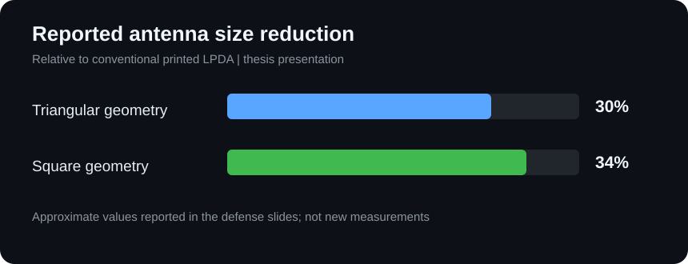

# Miniaturized Printed Log-Periodic Dipole Antenna (LPDA)

**Undergraduate thesis project** · Electronics and Communications Engineering · Kocaeli University

## Project overview

This project investigates a **miniaturized printed log-periodic dipole antenna (LPDA)** for wideband wireless communication applications. The work considers frequency bands used by RFID, GSM, GPS, 3G, Bluetooth, and 2.4 GHz Wi-Fi systems.

A conventional printed LPDA is the reference design. Its straight dipole elements are modified into **triangular** and **square** geometries to investigate physical size reduction and the resulting electromagnetic performance. The antenna configurations are modeled in **CST Microwave Studio** on an **FR4 dielectric substrate**.

## Antenna design

| Design | Description |
| --- | --- |
| **Conventional LPDA** | Reference antenna with straight printed dipole elements |
| **Triangular LPDA** | Modified dipole geometry targeting a smaller physical footprint |
| **Square LPDA** | Alternative modified dipole geometry targeting further compactness |

The baseline design described in the thesis uses **11 dipole elements** and an **initial target range of 0.9–2.0 GHz**. The FR4 substrate parameters are:

| Parameter | Value |
| --- | ---: |
| Relative permittivity (εr) | 4.3 |
| Loss tangent (tan δ) | 0.025 |
| Substrate thickness | 1.52 mm |
| Feed impedance | 50 Ω |

## Simulation methodology

The designs are evaluated and compared in CST Microwave Studio using:

- **S11 (reflection coefficient):** to assess impedance matching across frequency
- **VSWR:** to evaluate standing-wave behavior at the input
- **Radiation patterns:** to compare directional radiation characteristics
- **Physical dimensions:** to quantify size reduction relative to the reference design

The comparison focuses on whether a more compact LPDA can retain useful wideband performance.

## Results

### Physical size reduction

| Antenna configuration | Reported size reduction |
| --- | ---: |
| Triangular dipole geometry | Approximately **30%** |
| Square dipole geometry | Approximately **34%** |

### Impedance matching and radiation

The defense presentation reports wideband behavior and **S11 below −10 dB** for the evaluated modified designs. It also gives these **1.05 GHz** radiation-pattern results:

| Configuration | Maximum directional gain | 3 dB beamwidth | Main-lobe direction |
| --- | ---: | ---: | ---: |
| Conventional LPDA | 0.225 dBi | 79.4° | 0° |
| Triangular geometry | 0.404 dBi | 82.1° | 0° |
| Square geometry | 0.7 dBi | 83.3° | 180° |

These values are **reported simulation results from the thesis presentation**, not independent experimental measurements. The associated plots and antenna-model views are included in the thesis and presentation files below.

## Repository contents

| File | Contents |
| --- | --- |
| [Miniaturized_Printed_LPDA_Thesis.docx](Miniaturized_Printed_LPDA_Thesis.docx) | Full undergraduate thesis, design theory, and results |
| [LPDA_Thesis_Defense_Presentation.pptx](LPDA_Thesis_Defense_Presentation.pptx) | Antenna geometries, S11 / VSWR plots, and radiation-pattern comparisons |
| [LPDA_Research_Poster_2026.pptx](LPDA_Research_Poster_2026.pptx) | Academic research poster |
| [Miniaturized_Printed_LPDA_CST_Model.cst](Miniaturized_Printed_LPDA_CST_Model.cst) | Native CST Microwave Studio antenna project |

The `.cst` project can be opened with compatible CST Studio Suite software.

## Academic information

- **Author:** İrem Buğday
- **Supervisor:** Prof. Dr. Gonca Çakır
- **University:** Kocaeli University
- **Department:** Electronics and Communications Engineering
